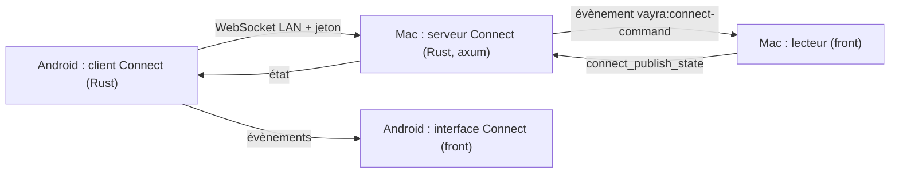

# VAYRA Connect — plan

Dernière mise à jour : 24 octobre 2026.

Relier l'app macOS et l'app Android de VAYRA comme Spotify relie son app de
bureau et son app mobile : le téléphone voit ce que joue le Mac, le pilote, y
lance un titre, et la lecture passe d'un appareil à l'autre à la même seconde.

## Décisions

- **Réseau local d'abord.** Mac et téléphone sur le même Wi-Fi, appairés une
  fois par QR. Rien ne transite par un serveur, aucun compte n'est requis. Un
  relais par le compte VAYRA (Supabase Realtime, comme VEYA) pourra suivre.
- **Trois fonctions en v1** : télécommande, lancement sur le Mac, transfert de
  lecture dans les deux sens.
- **Essais sur l'émulateur** `harbor_pixel6` ; le téléphone réel viendra après.
- **Tout est construit dans VAYRA.** L'app Android est celle de ce dépôt (Tauri
  mobile, lecteur ExoPlayer `HarborExoBridge.kt`, interface `src/mobile/`).

## Architecture

- **Serveur sur le Mac**, dans un module Rust dédié, distinct du serveur web
  (port 11471) : il n'écoute que si l'utilisateur active Connect et n'expose
  qu'une route WebSocket.
- **Le front du Mac reste la source de vérité.** Il publie l'état du lecteur ; les
  commandes reçues passent par les mêmes contrôles que le clavier et Now Playing,
  donc le cast et les salles VARA suivent.
- **Client côté Android en Rust.** L'interface tourne dans une WebView servie en
  `https://tauri.localhost` : une WebSocket `ws://` vers le réseau local y serait
  bloquée comme contenu mixte. Le Rust tient la connexion et relaie au front.
- **Une source par appareil, comme VARA.** On transmet le titre (identifiant de
  catalogue, épisode, position), jamais l'URL d'un flux : celle du Mac pointe
  souvent vers son moteur torrent local (`127.0.0.1`). L'appareil qui reprend
  ouvre sa propre source.

## Protocole (version 1)

Messages JSON, champ `type`. Positions en secondes.

| Sens | Message | Contenu |
|---|---|---|
| les deux | `hello` | `deviceId`, `name`, `platform`, `protocol: 1` |
| Mac → téléphone | `state` | `status`, `positionSec`, `durationSec`, `rate`, `volume`, `muted`, `title`, `meta` (`id`, `type`, `name`, `poster`), `episode` (`season`, `episode`), `at` |
| Mac → téléphone | `idle` | rien ne joue |
| téléphone → Mac | `command` | `play`, `pause`, `toggle`, `seek` (`position`), `skip` (`seconds`), `volume` (`level`), `stop` |
| téléphone → Mac | `load` | `meta`, `episode`, `startSec` : lancer ce titre sur le Mac |
| téléphone → Mac | `requestState` | renvoyer l'état courant |

Transfert Mac → téléphone : le téléphone lit l'état, ouvre le même titre à la
même position avec sa propre source, puis envoie `pause` au Mac. Transfert
téléphone → Mac : `load` avec la position, puis pause locale.

## Sécurité

- Connect est désactivé par défaut ; l'activer affiche le QR d'appairage.
- QR : `vayra://connect/pair#h=<ip:port>&k=<secret>&n=<nom>` — le secret reste
  dans le fragment, comme les liens VARA.
- Secret aléatoire de 32 octets, conservé dans les données de l'app du Mac ;
  « Déconnecter les téléphones » le remplace et coupe toutes les connexions.
- Une connexion sans le bon secret est refusée avant toute lecture de message ;
  les messages inconnus ou trop gros ferment la connexion.
- Aucune commande ne touche aux fichiers, aux comptes ni aux réglages.

## Étapes

Chaque étape : branche, micro-commits poussés, PR fusionnée quand la CI est verte.

1. **Android de base** — compiler l'APK depuis `main`, la lancer sur
   l'émulateur, noter ce qui marche (accueil, fiche, lecture ExoPlayer) et
   réparer ce qui bloque. *Critère : un épisode se lit sur l'émulateur.*
2. **Serveur Connect sur le Mac** — module Rust, réglage, QR, secret, publication
   de l'état, exécution des commandes. *Critère : un client de test sur le Mac
   pilote une lecture et reçoit l'état ; tests Rust d'authentification et de
   messages.*
3. **Client Connect Android** — appairage par lien profond (`adb shell am start`
   sur l'émulateur), connexion Rust, reconnexion. *Critère : l'émulateur affiche
   l'état du Mac.*
4. **Télécommande et lancement** — barre « En cours sur le Mac » et contrôles ;
   bouton « Lire sur le Mac » sur la fiche. *Critère : l'émulateur met en pause,
   avance et lance un épisode sur le Mac.*
5. **Transfert de lecture** — « Lire sur ce téléphone » / « Lire sur le Mac ».
   *Critère : la lecture passe d'un appareil à l'autre à ±2 s.*
6. **Découverte mDNS et finitions** — retrouver le Mac quand son IP change,
   plusieurs Mac, revue de design datée.

## Hors périmètre de la v1

Relais cloud, iOS, contrôle d'un téléphone depuis le Mac autrement que par le
transfert, et partage de fichiers locaux entre appareils.
